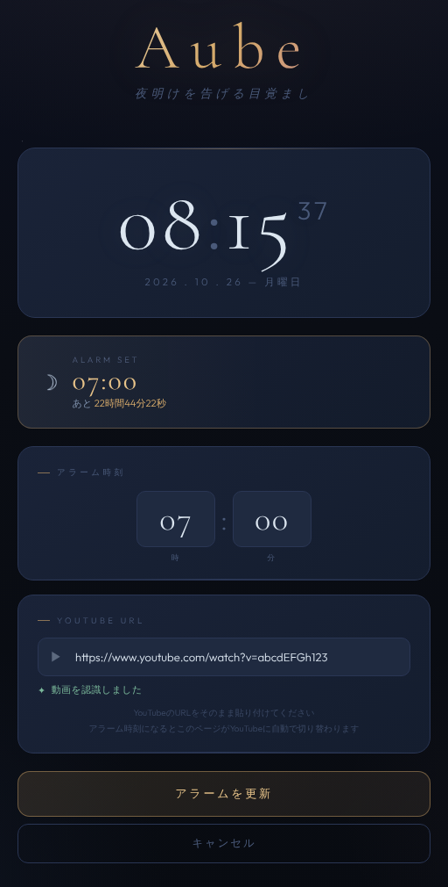

# Aube

指定した時刻に、好きな YouTube 動画を開いて起こしてくれるブラウザ用の目覚まし時計です。

HTML ファイル1つで動作し、インストールやビルドは不要です。

**デモ:** https://mimish0778.github.io/aube/



## 機能

- 現在時刻（時・分・秒）と日付・曜日の表示
- アラーム時刻を時（0〜23）と分（0〜59）のプルダウンで指定
- YouTube の URL を貼り付けると動画 ID を自動で読み取り、認識できたかを表示
- アラーム設定中は、設定時刻と発火までの残り時間をカウントダウン表示
- 設定はブラウザに保存され、ページを再読み込みしても復元
- 設定時刻になると、開いているタブがその動画のページ（`autoplay=1` 付き）に切り替わる

## 使い方

1. [デモページ](https://mimish0778.github.io/aube/) を開くか、このリポジトリの `index.html` をブラウザで直接開きます。
2. 「アラーム時刻」で起きたい時刻を選びます。
3. 「YouTube URL」に、目覚ましに使いたい動画の URL を貼り付けます。正しく読み取れると「動画を認識しました」と表示されます。
4. 「アラームをセット」を押します。
5. タブを開いたまま待ちます。設定時刻になると、そのタブが YouTube の動画ページに切り替わります。

設定を変えるときは、同じ手順で入力して「アラームを更新」を押します。解除するときは「キャンセル」を押します。

### ローカルで動かす

```bash
git clone https://github.com/mimish0778/aube.git
cd aube
```

クローンした `index.html` をブラウザで開くだけで使えます。フォントは Google Fonts から読み込むため、オフラインでは代替フォントで表示されます。

## 対応している URL の形式

次の形式から 11 文字の動画 ID を取り出します。

```
https://www.youtube.com/watch?v=VIDEO_ID
https://youtu.be/VIDEO_ID
https://www.youtube.com/embed/VIDEO_ID
https://www.youtube.com/shorts/VIDEO_ID
```

`&t=30` などのパラメータが付いていても読み取れますが、アラーム発火時に開くのは `https://www.youtube.com/watch?v=VIDEO_ID&autoplay=1` です。再生開始位置などの元のパラメータは引き継がれません。

## 仕組み

- 1 秒ごとに現在時刻を確認し、時と分が設定と一致した時点で `window.location.href` を YouTube の URL に書き換えます。新しいウィンドウを開くのではなく、このページ自体が移動するため、ポップアップブロックの影響を受けません。
- 設定は `localStorage` の `aube_alarm` キーに次の形式で保存されます。

  ```json
  { "h": 7, "m": 30, "videoId": "xxxxxxxxxxx" }
  ```

- 設定時刻をすでに過ぎている場合、カウントダウンは翌日の同じ時刻までの残り時間を表示します。
- 発火後も設定は保存されたままなので、もう一度ページを開くと同じアラームが有効な状態で表示されます。不要になったら「キャンセル」で解除してください。

## 注意事項

- **タブを開いたままにしておく必要があります。** 時刻の確認はページ内の JavaScript で行っているため、タブやブラウザを閉じたり、端末がスリープしたりするとアラームは鳴りません。
- バックグラウンドのタブでは、ブラウザや OS の省電力機能によってタイマーが遅れたり止まったりすることがあります。設定した「分」の間に一度も確認が行われなかった場合、アラームは発火しません。
- 自動再生されるかどうか、音が出るかどうかはブラウザの自動再生ポリシーに左右されます。再生ボタンを押す必要がある場合もあります。
- 設定はブラウザごとに保存されるため、別のブラウザや端末とは共有されません。
- スヌーズ機能はありません。
- 寝坊できない予定がある日は、スマートフォンなどの標準のアラームと併用してください。

## 技術構成

- HTML / CSS / JavaScript（ライブラリやフレームワークは不使用）
- フォント: [Cormorant Garamond](https://fonts.google.com/specimen/Cormorant+Garamond)、[Outfit](https://fonts.google.com/specimen/Outfit)（Google Fonts）

配色は `index.html` 内の `:root` に CSS 変数（`--dawn-gold`、`--midnight` など）としてまとめてあります。

## ライセンス

[MIT License](LICENSE)
